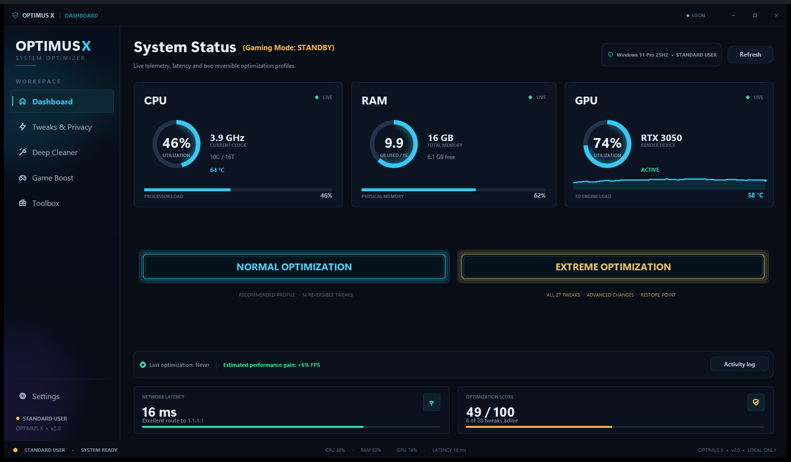

# ⚡ OPTIMUS X

### The Windows optimizer built for gamers

Cut background noise, lower latency and free up resources, **with every change backed up and reversible.**


<br>



</div>

<br>

## ✨ Why Optimus X?

Windows ships with a lot you never asked for: preinstalled apps, background services, telemetry and effects that eat RAM, CPU and frame time. Optimus X lets you switch them off from one clean dashboard, and **undo anything** if you change your mind.

| | |
| --- | --- |
| 🛡️ **Reversible by design** | Original values are saved before every change. One click restores them. |
| 🧪 **Dry-run mode** | Preview exactly what would happen without touching your system. |
| 🔒 **100% local** | No accounts, no cloud, no telemetry. Nothing leaves your PC. |
| 📋 **Full activity log** | Every change is written to a readable log you can review any time. |
| 🎮 **Made for gaming** | A competitive profile that targets latency and frame-time consistency. |

<br>

## 🚀 What you can do

### 📊 Dashboard
Live **CPU, RAM and GPU** gauges, temperature, network latency and an optimization score. Two one-click profiles:
- **Normal optimization:** the recommended, low-risk set of tweaks.
- **Extreme optimization:** every reversible tweak, for maximum performance.

### 🔧 Tweaks & Privacy
Turn individual tweaks on or off, review them, then apply everything in one batch. Each tweak shows its **risk level** and whether it needs a **reboot**.

### 🧹 Deep Cleaner
- Remove preinstalled apps: **Xbox, Mail, Maps, Movies & TV, Weather, Phone Link, Cortana, Teams, Clipchamp** and more.
- Uninstall **Microsoft Edge** and **OneDrive** (optional).
- Disable **Windows Copilot** and **Recall**.
- Remove **Windows Media Player Legacy** and **DirectPlay**.
- Clean temporary files, shader cache, crash dumps, update caches and the Recycle Bin.

### 🎮 Game Boost
Activate the competitive gaming profile with one switch, change your power plan and close memory-hungry background apps.

### 🧰 Toolbox
Create a **restore point**, run **SFC** and **DISM** repairs, reset the network stack, restart Explorer, check disk health and export a full system report.

### ⚙️ Settings
See your administrator status, enable dry-run mode, revert every change at once and read the activity log.

<br>

## 🎯 What gets optimized

<details>
<summary><b>🗑️ Debloat and components</b></summary>

<br>

- Preinstalled UWP/AppX apps (only the ones actually installed are shown)
- Microsoft Edge and OneDrive, including OneDrive's entry in the File Explorer sidebar
- Windows Copilot and Recall
- Windows Media Player Legacy and DirectPlay

</details>

<details>
<summary><b>🛠️ Windows services</b></summary>

<br>

- **SysMain (SuperFetch):** stops useless app preloading and extra SSD writes
- **Windows Search:** stops the indexer from scanning your drives while you play
- **Windows Update (controlled mode):** manual start, asks before downloading or installing, and never restarts your PC while you are signed in
- **Telemetry:** DiagTrack, push service and the compatibility / CEIP scheduled tasks
- **Minor services:** Fax, Geolocation, Print Spooler, Downloaded Maps, Xbox Live and WMP network sharing

</details>

<details>
<summary><b>🧠 Registry and kernel</b></summary>

<br>

- Keep kernel and drivers in RAM (`DisablePagingExecutive`)
- Foreground game priority and multimedia scheduling
- Power Throttling off
- Raw mouse input (no pointer acceleration) and USB selective suspend off
- Hardware-accelerated GPU scheduling (HAGS) on or off
- Hibernation off (frees several GB), Game Bar / DVR off, fullscreen optimizations off

</details>

<details>
<summary><b>🌐 Network and latency</b></summary>

<br>

- Nagle's algorithm and delayed ACK off on your active adapters
- Network throttling removed
- DNS cache tuning
- Reserved QoS bandwidth released

</details>

<details>
<summary><b>🖥️ Interface and visual effects</b></summary>

<br>

- Transparency, window animations, Aero Peek and drag-full-windows off
- File Explorer performance mode (icons instead of thumbnails, no status bar)

</details>

<details>
<summary><b>💾 Disk cleanup</b></summary>

<br>

- User and Windows temp files
- DirectX shader cache and crash dumps
- Thumbnail cache
- Delivery Optimization and Windows Update caches
- Recycle Bin

</details>

<br>

## 📦 Installation

Installing Optimus X takes less than a minute. **You don't need Python or any other tool.**

<div align="center">

### [⬇️ Download the latest installer](https://github.com/eww-didac/OPTIMUS-X/releases/latest)

</div>

**1.** Open the link above and, under **Assets**, download **`OptimusX-Setup-x.x.x.exe`**.

**2.** Double-click the file you downloaded.

**3.** If Windows shows *"Windows protected your PC"*, click **More info → Run anyway**. This appears because the installer is not code-signed yet; it is a normal warning for new, independent apps.

**4.** Click **Next → Install**, then **Finish**.

**5.** Open **Optimus X** from your desktop or Start menu. Accept the Windows (UAC) prompt so every feature can work.

That's it. 🎉

**Requirements:** Windows 10 or Windows 11, 64-bit.

**To uninstall:** *Settings → Apps → Installed apps → Optimus X → Uninstall*. Your settings and backups stay in `%LOCALAPPDATA%\OptimusX`, so you can still revert tweaks if you reinstall later.

<details>
<summary><b>🧑‍💻 Advanced: run from source code</b></summary>

<br>

For developers only. You need [Python 3.11+](https://www.python.org/downloads/) (tick **"Add Python to PATH"**).

```powershell
git clone https://github.com/eww-didac/OPTIMUS-X.git
cd OPTIMUS-X
python -m pip install -r requirements.txt
python main.py
```

To build the installer yourself, install [Inno Setup 6](https://jrsoftware.org/isdl.php) and run:

```powershell
powershell -ExecutionPolicy Bypass -File .\build.ps1
```

</details>

<br>

## 🧭 How to use it

1. **Start with the Dashboard** and review your system status.
2. *(Recommended)* Turn on **Dry-run mode** in Settings to preview changes safely.
3. Click **Normal optimization**, or open **Tweaks & Privacy** and pick the tweaks you want.
4. **Read the confirmation window.** It lists every change, its risk level and any warning.
5. Keep **"Create a restore point"** ticked, then confirm.
6. **Restart Windows** if the app tells you a reboot is needed.

Changed your mind? Go to **Settings → Revert backed-up tweaks** and everything returns to how it was.

<br>

## 🛡️ Your safety

Optimus X was designed so you stay in control.

- ✅ **Nothing runs without your confirmation.** You always see what will change first.
- ✅ **Every original value is backed up** before it is modified.
- ✅ **One-click revert** for each tweak, or all of them at once.
- ✅ **Optional Windows restore point** before applying a profile.
- ✅ **Smart cleanup protections:** it never follows links and refuses dangerous folders.
- ✅ **No hidden behavior:** it never downloads code or bundles third-party installers.

<details>
<summary><b>📁 Where is my data stored?</b></summary>

<br>

Everything lives in `%LOCALAPPDATA%\OptimusX`:

| Folder | Contents |
| --- | --- |
| `data\` | Your preferences and the backups used to revert changes |
| `logs\` | A readable activity log and a technical log |
| `reports\` | System reports you export from the Toolbox |

> ⚠️ Revert your tweaks from **Settings** *before* deleting this folder, because the backups are what make changes reversible.

</details>

<br>

## ❓ FAQ

<details>
<summary><b>Is it safe?</b></summary>

<br>

It is designed to be: confirmations, backups, a restore point and a revert button. Still, it changes real Windows settings, so read each confirmation window and keep a restore point.

</details>

<details>
<summary><b>Do I need administrator rights?</b></summary>

<br>

For changes to services, the system registry and installed apps, yes. The app opens normally without them and offers to restart as administrator when you need it.

</details>

<details>
<summary><b>Windows SmartScreen or my antivirus shows a warning.</b></summary>

<br>

The installer is not code-signed yet, and security tools can be cautious about anything that edits system settings. In SmartScreen click **More info → Run anyway**. You can read the full source code in this repository.

</details>

<details>
<summary><b>Why does a tweak say "No saved backup" when I revert it?</b></summary>

<br>

That value was already set before you used Optimus X, or its backup was deleted. The app cannot know the original value, so change it manually in Windows if you want it undone.

</details>

<details>
<summary><b>The Edge uninstall failed.</b></summary>

<br>

Some Windows builds and regions block it. Windows can also reinstall Edge after a feature update.

</details>

<details>
<summary><b>I don't see a CPU temperature.</b></summary>

<br>

The reading needs administrator rights, and not every motherboard exposes it. All other gauges still work.

</details>

<details>
<summary><b>The window opened off-screen.</b></summary>

<br>

Delete `%LOCALAPPDATA%\OptimusX\data\settings.json` and start the app again.

</details>

<details>
<summary><b>I get <code>ModuleNotFoundError: customtkinter</code> (running from source).</b></summary>

<br>

Run `python -m pip install -r requirements.txt` again, in the project folder. This does not happen with the installer.

</details>

<br>

## ⚠️ Good to know

- Some tweaks trade a feature for speed. For example, turning off Search indexing makes Start-menu searches slower. Each card tells you the trade-off before you apply it.
- Pinning the kernel in RAM is only recommended with **16 GB of RAM or more**.
- The app list is curated. It never includes the Microsoft Store, system-critical packages or frameworks.
- The "estimated FPS gain" on the Dashboard is a rough guide, not a measured result.

<br>

## 📜 Disclaimer

Optimus X is provided **as-is, without warranty of any kind**. It modifies Windows services, registry values, installed packages and temporary files. Use it on a machine you can restore, keep a Windows restore point or system image, and review each dialog before confirming. The authors are not responsible for data loss, reduced functionality or policy violations resulting from its use.

<br>

## 📄 License

Released under the [MIT License](LICENSE).

<br>

<div align="center">

**If Optimus X helped you, consider leaving a ⭐ on the repository.**

</div>
E(2).md…]()
